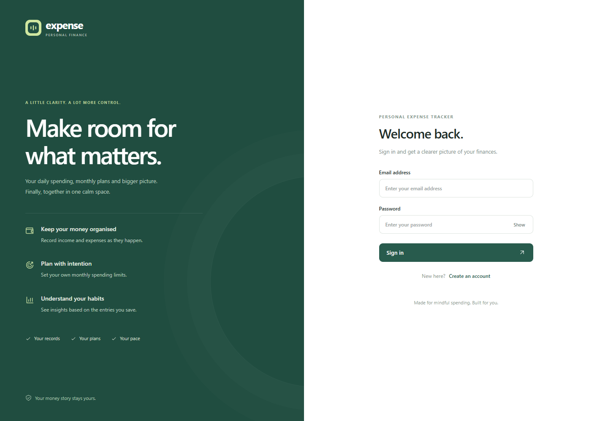

# Personal Expense Tracker

A small web app for keeping track of income, everyday expenses and monthly budgets. It brings your records together so you can see where your money goes without maintaining a spreadsheet.

Built with **Node.js, Express and SQLite**, with plain HTML, CSS and JavaScript on the frontend.



## What you can do

- Create a private account and confirm it with a six-digit verification code.
- Add income and expenses, then edit or delete entries when needed.
- Search your history and filter it by month, category or transaction type.
- Check monthly income, spending, net balance and savings rate.
- See spending by category and compare weekly income with expenses.
- Set monthly category budgets and see how much is left to spend.
- Download a CSV statement of the records you are viewing.
- Use the same website on a phone, tablet or desktop.

Accounts start empty. There are no preset users, transactions or budgets, and the sign-in page does not show financial figures. All totals come from the entries you save. The built-in categories are just labels to help organise those entries.

## Email verification

Creating an account takes two steps. After entering your name, email and password, the app sends a six-digit code. The account is not created until that code is entered correctly. Codes expire after 10 minutes, allow five attempts and can be resent after 60 seconds.

### Connect a real email sender

The app uses SMTP, so it works with Gmail, Outlook, Brevo or another email provider. Fill in the SMTP settings in the `.env` file:

```text
OTP_SECRET=your-long-random-value
SMTP_HOST=smtp.gmail.com
SMTP_PORT=465
SMTP_SECURE=true
SMTP_USER=your-email@gmail.com
SMTP_PASS=your-app-password
OTP_FROM=your-email@gmail.com
```

For Gmail, turn on two-step verification and create an **App Password**; use that 16-character password as `SMTP_PASS`. Never put a normal Google password in the file. `.env` is ignored by Git. If port 465 is blocked, use port 587 with `SMTP_SECURE=false` instead.

Both npm scripts load `.env` automatically. Restart the server after changing it. `OTP_SECRET` keeps pending codes valid across a restart.

### Without email settings

If SMTP is not configured, the app still works for local testing: the code is printed in the **server window**. The website says this on the verification screen. That fallback is convenient on a personal computer, but it is not suitable for a public deployment because anyone who can see the terminal can read the code.

## Run it locally

Install **Node.js 24 or newer**, then run:

```bash
git clone https://github.com/diwanpinjari/Expense_track.git
cd Expense_track
npm install
npm start
```

Open **http://localhost:3100** and choose **Create an account**.

Keep the server terminal window open while using the app. If the browser opens before the server is ready, refresh the page once.

If PowerShell blocks `npm`, use `npm.cmd install` and `npm.cmd start` instead.

For development, `npm run dev` restarts the server when its source files change. There is no frontend build step.

## Deploy on Vercel

Vercel runs the app as a serverless function, so it cannot keep the local `data/expenses.db` file between requests. The hosted version uses a free Turso database instead. Your local copy keeps using `data/expenses.db`.

1. Push this project to GitHub.
2. In Vercel, choose **Add New → Project** and import the repository.
3. Open the project's **Storage** or **Marketplace** tab, add **Turso Cloud**, create a database, and connect it to the project. This adds `TURSO_DATABASE_URL` and `TURSO_AUTH_TOKEN` to the project automatically.
4. Add these environment variables in **Settings → Environment Variables**:

   ```text
   OTP_SECRET=your-long-random-value
   SMTP_HOST=smtp.gmail.com
   SMTP_PORT=465
   SMTP_SECURE=true
   SMTP_USER=your-email@gmail.com
   SMTP_PASS=your-app-password
   OTP_FROM=your-email@gmail.com
   ```

5. Deploy the project. Vercel detects `server.js` as the Express app and serves the files in `public/` from its CDN.
6. Open the deployment URL and create an account. The verification email is sent through the SMTP settings above.

Vercel allows outbound SMTP on ports `465` and `587`; it blocks port `25`.

### Move your existing records to Turso

The local database is deliberately excluded from deployment, so your existing account and entries are not uploaded automatically. Copy them once, after the Turso database is connected:

```powershell
$env:TURSO_DATABASE_URL="libsql://your-database-url"
$env:TURSO_AUTH_TOKEN="your-turso-token"
npm.cmd run migrate:turso
Remove-Item Env:TURSO_DATABASE_URL
Remove-Item Env:TURSO_AUTH_TOKEN
```

The migration copies accounts, transactions and budgets. It stops without changing anything if the Turso database already contains an account. Your local database is not modified. Sign in on the deployed website with the same email and password as before.

The app stops with a clear error if it is deployed to Vercel without `TURSO_DATABASE_URL`. This prevents the serverless function from silently writing to temporary storage.

## How it works

Locally, Express serves the website and handles the API, while SQLite stores accounts, transactions and budgets in `data/expenses.db`. On Vercel, the same API runs as a serverless function and Turso stores the records in the cloud. The browser code is identical in both cases.

Amounts are stored as integer paise to keep calculations exact. Reports and budget figures are calculated from the ledger, so changing or deleting an entry also changes the totals.

Passwords are stored as salted scrypt hashes. Verification codes are stored as keyed hashes, not plain text. Sessions use HTTP-only cookies, write requests require CSRF tokens, and database queries are restricted to the signed-in user. CSV exports escape fields and neutralise spreadsheet formulas.

## A few details about the totals

- **Net balance** is income minus expenses for the selected month. It is not a bank balance.
- **Savings rate** is net balance divided by income. A dash is shown when no income has been recorded.
- **Weekly charts** group days 1–7, 8–14, 15–21, 22–28 and 29–31.
- **Budgets** apply to a category in a particular month. Going over a limit shows a warning but does not stop you recording an expense.

Transactions are entered manually. Bank connections, payment processing and automatic recurring entries are not included.

## Tests

```bash
npm test
```

The 18 tests cover money and date validation, empty accounts, OTP creation and expiry, incorrect-attempt limits, sign-in, account isolation, transaction changes, monthly totals, budgets, CSV export and database constraints. They use a separate in-memory database and do not touch your saved records.

## Project layout

```text
server.js                 Express server, authentication and API
db.js                     SQLite schema and local/Turso database adapters
lib.js                    Money, date, password and OTP helpers
mailer.js                 Optional SMTP delivery for verification codes
vercel.json               Vercel function settings
.vercelignore             Keeps local data and secrets out of deployments
scripts/
  migrate-to-turso.js     Copies local records to the hosted database
public/
  index.html              Website entry point
  app.js                  Screens and browser interactions
  styles.css              Desktop and mobile styles
  favicon.svg             App icon
test/app.test.js          Automated tests
screenshots/              Screens captured from the running app
```

## Your data

The `data` folder is created on the first run and is excluded from Git and from Vercel deployments. Refreshing the page or restarting the server does not reset your records.

To make a backup, stop the server and copy the entire `data` folder. Restore it with the server stopped. Deleting that folder removes all local accounts and records; the next start creates an empty database.

The local server listens on `127.0.0.1`, so it is available only on your computer. To use another port in PowerShell:

```powershell
$env:PORT=3101
npm.cmd start
```

Then open `http://localhost:3101`. Vercel chooses its own port automatically.

---

Software Engineering project — **E PRAVEENA · 26AG5A0517**.
